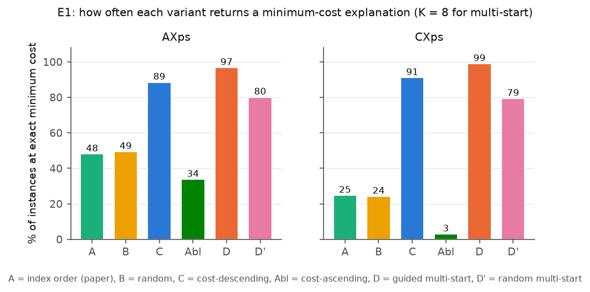
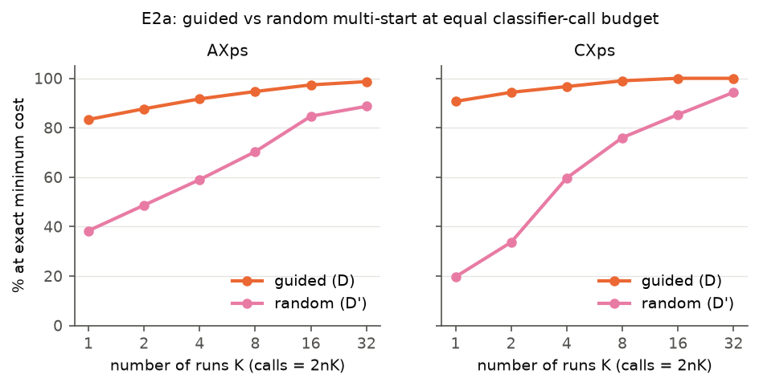
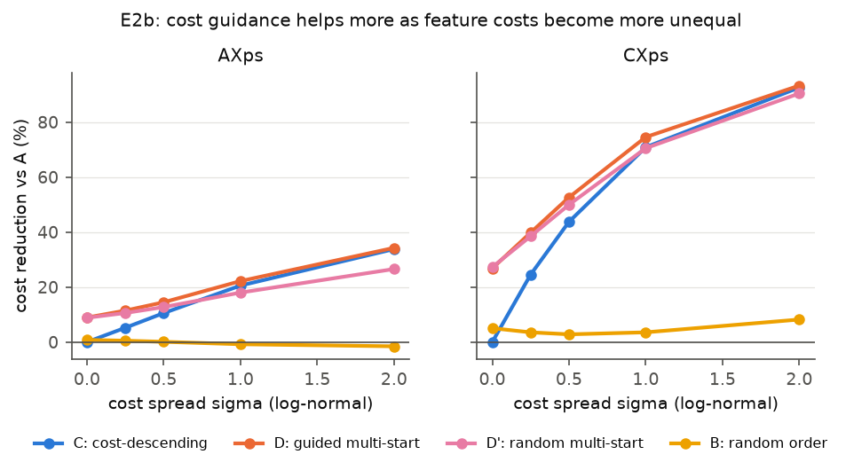
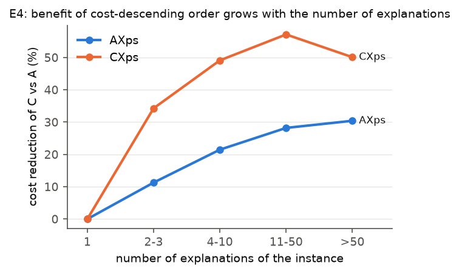

# Cost-Aware Selection of Formal Explanations for Monotonic Classifiers

Course project for Explainable AI (DS5622), Track 2 (extension of a research paper).

Team: Yasir Z (142301037), Tanishq Chandra (142301035)

Source paper: J. Marques-Silva, T. Gerspacher, M. Cooper, A. Ignatiev, N. Narodytska.
*Explanations for Monotonic Classifiers.* ICML 2021, PMLR 139.

---

## TL;DR

A prediction can often be explained in several different but equally valid ways. The
paper's algorithms return whichever one the (arbitrary) feature order leads to. We give
each feature a cost and process **expensive features first**, which steers the algorithm
to a **cheaper explanation** with the **same number of classifier calls** and the same
formal guarantees. On 1200 synthetic instances this raises the share of minimum-cost
explanations from 48% to 89% (AXp) and from 25% to 91% (CXp), and lowers total cost by
18% (AXp) and 69% (CXp). A small multi-start variant (K = 8 runs) gets 97% / 99%.
All 1200 explanations passed an independent validity check, and our reimplementation
reproduces the authors' outputs exactly on all 139 benchmark instances.

## 1. Background

**Monotonic classifiers.** A classifier is monotonic if increasing an input feature can
never lower the predicted class (e.g. in credit scoring, a higher income should never
make the risk class worse). Many real models are built this way on purpose.

**Formal explanations.** For a prediction `k(v) = c`:

- an **AXp** (abductive explanation, "why?") is a subset-minimal set of features such
  that, if those features keep their values in `v`, the prediction stays `c` whatever
  the other features do. Example: "grade A because Quiz = 10 and Exam = 10; homework and
  project don't matter."
- a **CXp** (contrastive explanation, "why not?") is a subset-minimal set of features
  that, if allowed to change, *can* change the prediction. Example: "changing only the
  Exam mark could change the grade."

Unlike LIME or Anchor, these explanations are guaranteed to be correct.

**The paper's algorithms.** findAXp and findCXp compute one such explanation using only
black-box calls to the classifier. To test whether a feature can be freed, they evaluate
the classifier on the lowest and highest corners of the box of allowed inputs; because
the model is monotonic, if both corners get the same class then every point in between
does too. So each feature costs just 2 classifier calls.

Both algorithms go through the features one by one and try to drop each feature from the
explanation. The result is always subset-minimal, but not necessarily the smallest or
cheapest explanation, and which one you get depends on the order in which features are
processed. The paper notes this but always uses index order 1..N.

The authors' implementation (XMono, https://github.com/jpmarquessilva/xmono) is written
in Perl, targets Linux and calls classifiers through external processes, so we
reimplemented the algorithms in Python. We use XMono's benchmark data and output logs to
check that our implementation gives the same explanations (experiment E0).

## 2. Research question and hypothesis

**Question.** Can cost-guided feature ordering, plus a small multi-start budget, reduce
the cost of the returned explanation compared with fixed and random ordering, while
keeping the explanation formally valid?

**Hypothesis.** Cost guidance helps most when an instance has several different
explanations and feature costs vary a lot. When there is only one AXp/CXp, or all costs
are equal, it should make no difference.

We do not claim to find the minimum-cost explanation in general.

## 3. Method

Each feature `i` gets a positive cost `c_i` (synthetic). The cost of an explanation is
the sum of the costs of its features.

**Which order.** In both algorithms a feature processed early is more likely to be
dropped, because the features processed later have to make up for it. So expensive
features should be tried first: sort by cost, **descending**, ties broken by index
(with equal costs this is exactly the original algorithm).

Example: `k(x) = x1 OR x2`, `v = (1,1)`, `c = (10, 1)`. Order (1,2) gives AXp {2}
(cost 1), order (2,1) gives AXp {1} (cost 10).

Greedy ordering is not always optimal: for `k(x) = x1 OR (x2 AND x3)`, `v = (1,1,1)`,
`c = (5,3,3)`, descending order returns {2,3} (cost 6) although {1} (cost 5) is an AXp.
This is why we also try a multi-start version.

**Multi-start.** Run the algorithm K times and keep the cheapest result. Run 1 uses the
plain descending order, the others sort by `c_i * exp(tau * e_i)`, `e_i ~ N(0,1)`.
Every run returns a valid explanation, so the selected one is valid too. Each run costs
exactly `2n` classifier calls, so two multi-start variants with the same K use the same
number of calls.

| ID | Variant | Calls |
|----|---------|-------|
| A  | Original index order (paper / XMono) | 2n |
| B  | One random order | 2n |
| C  | Cost-descending order (our proposal) | 2n |
| Abl| Cost-ascending order (ablation) | 2n |
| D  | Cost-guided multi-start, K = 8, tau = 0.5 | 2nK |
| D' | Random multi-start, same K (matched baseline) | 2nK |

(findCXp makes 2 extra calls at the start to check that the prediction can change at all.)

**Exact reference.** The minimum-cost explanation is found by enumerating all AXps and
CXps with Algorithm 3 of the paper (SAT-based, PySAT) and taking the cheapest. We also
implemented an implicit hitting-set solver (weighted MaxSAT with RC2, `mono/exact.py`),
which is tested against brute force, but it was far too slow on some linear instances with
n = 20 (minutes, vs. 0.1 s for enumeration), so the experiments use enumeration.
Enumeration is stopped after 2000 explanations; this happened for 1.8% of the E1 instances
(all linear, n = 20), which are left out of the optimality metrics.

**Validity.** Every returned explanation is checked by `mono/verify.py`, which does not
reuse the algorithm code: "prediction can change" claims are checked with a concrete
counterexample point, "prediction cannot change" claims with the bound test plus 128
random points in the box.

## 4. Classifiers and costs

- Synthetic monotonic classifiers on [0,1]^n (`models/synthetic.py`): thresholded linear
  model with non-negative weights (binary), max of 3 sparse linear scores (4 classes),
  monotone DNF over thresholded features (binary). Monotonicity is checked in the tests.
- The two classifiers used by XMono (`models/xmono_models.py`): the student grades
  example from the paper and the BankruptcyRisk decision tree.
- Costs: log-normal with spread sigma, normalised to mean 1 (sigma = 0 means equal costs).
  Each instance (classifier, point, costs) is generated from a seed, so all variants are
  compared on exactly the same instances.

## 5. Results

All numbers below are in `results/summary.md` (generated by `analysis/analyze.py`).
"% optimal" = share of instances where the variant returns a minimum-cost explanation.
"Cost reduction vs A" = 1 - (total cost of the variant) / (total cost of A).

### E0: agreement with XMono

| Benchmark | Instances | Same AXps as XMono | Same CXps as XMono | Verified |
|---|---|---|---|---|
| StudentGrades | 100 | 100 | 100 | 100 |
| BankruptcyRisk | 39 | 39 | 39 | 39 |

Tables 1-3 of the paper (the worked example) are also reproduced exactly in
`tests/test_explain.py`, including the classifier outputs at every step. The average
number of AXps on BankruptcyRisk (1.03) matches Table 4b of the paper.

### E1: main comparison (1200 synthetic instances, n in {8,12,16,20}, sigma = 1)

| Variant | AXp % optimal | AXp cost red. vs A | CXp % optimal | CXp cost red. vs A |
|---|---|---|---|---|
| A: index order | 48.1 | 0 | 24.8 | 0 |
| B: random order | 49.4 | -0.6% | 24.3 | -1.7% |
| C: cost-descending | 88.6 | 18.1% | 91.1 | 68.5% |
| Abl: cost-ascending | 33.8 | -14.0% | 3.0 | -115% |
| D: guided multi-start (K=8) | 96.8 | 19.3% | 99.0 | 70.3% |
| D': random multi-start (K=8) | 80.2 | 16.4% | 79.4 | 66.5% |

All returned explanations (100%) passed verification. Paired Wilcoxon tests on cost:
C is cheaper than A on 606 / 1200 instances for AXps (equal on 557, worse on 37,
p < 1e-90) and on 886 / 1200 for CXps (worse on 42, p < 1e-130). D is cheaper than D'
on 246 (AXp) and 252 (CXp) instances, and worse on 17 and 12 (p < 1e-35).

How to read this:

- A and B are about the same: with respect to cost, the paper's index order is
  effectively a random order.
- C uses exactly as many classifier calls as A (27.8 per AXp on average), so the
  improvement comes at no extra cost. D adds a few points at 8x the calls.
- D beats D' with the same number of calls, so the gain comes from the cost information,
  not just from re-running.
- CXps gain more than AXps because CXps here are small (1.36 features on average), so
  the choice is basically "which single feature?", and costs of single features differ a
  lot. AXps have about 6 features and share many of them, so there is less room to swap.
- We report % optimal, median gap and total-cost ratio rather than the mean gap, because a
  few instances where A picks one very expensive feature dominate the mean (CXp mean gap
  of A is 4.69, median 1.53; see `results/summary.md`).



### E2: sensitivity analysis (n = 16, 300 instances)

**Budget K.** One cost-guided run (K = 1, 32 calls) reaches the optimum on 83% of the
instances for AXps, about as often as 16 random runs (85%, 512 calls). For CXps, one
guided run reaches 91%, while 32 random runs still reach only 94%.



**Cost spread sigma.** With equal costs (sigma = 0) C is identical to A, as expected. The
benefit grows with sigma: for AXps from 5% (sigma = 0.25) to 34% (sigma = 2), for CXps
from 25% to 93%. With equal costs the multi-start variants still reduce cost (9% for AXps,
27% for CXps) because cost then equals size, so they act as a search for smaller
explanations.



**Perturbation strength tau (K = 8).** % optimal (AXp / CXp): 88.0 / 94.7 for tau = 0.1,
94.0 / 99.0 for tau = 0.5, 95.7 / 99.3 for tau = 1, 92.3 / 98.0 for tau = 2. Too little
noise repeats the same order; too much loses the cost information.

### E3: ablation

Sorting the wrong way (ascending) is clearly worse than the original order (AXp optimal
34% vs 48%, CXp 3% vs 25%). Multi-start without cost information (D') is better than a
single guided run only when K is large (see E2a). Both show that the gain comes from the
ordering, not from re-running the algorithm.

### E4: does it help more when there are many explanations?

| # explanations | AXp cost red. (C vs A) | CXp cost red. (C vs A) |
|---|---|---|
| 1 | 0% | 0% |
| 2-3 | 11.8% | 53.7% |
| 4-10 | 20.9% | 66.8% |
| 11-50 | 28.4% | 77.9% |
| >50 | 32.4% | 74.5% |

With a single explanation every order returns it, so there is nothing to gain. The
benefit grows with the number of explanations, which supports the hypothesis.



### E5: XMono's classifiers with random costs (5 cost draws per instance)

| Benchmark | AXps per inst. | A -> C, AXp % optimal | A -> C, CXp % optimal | CXp cost red. (C vs A) |
|---|---|---|---|---|
| StudentGrades | 1.23 | 87.2 -> 99.4 | 51.6 -> 98.2 | 43.2% |
| BankruptcyRisk | 1.03 | 99.0 -> 100 | 53.3 -> 100 | 46.3% |

On these small benchmarks most instances have only one AXp, so there is little to gain
for AXps, but CXps still benefit a lot.

### Verdict on the hypothesis: supported

1. Cost-guided ordering makes explanations substantially cheaper without losing validity
   (E1, 100% verified).
2. The gain is exactly zero where the hypothesis says it should be: instances with a
   single explanation (E4) and equal costs (E2, sigma = 0).
3. The gain grows with the number of explanations (E4) and with the cost spread (E2).
4. Using costs the wrong way (ascending) makes things worse, so the ordering is the
   cause of the effect (E3).

As stated at the start, the method does not guarantee the global minimum: C misses it on
about 10% of the instances, D on about 1-3%.

## 6. Discussion and limitations

- Cost-descending order costs nothing extra (same number of classifier calls as the
  original algorithm) and gives most of the improvement. Multi-start adds a smaller gain
  at K times the calls.
- The gain is larger for CXps than for AXps. CXps here are usually 1-2 features, so
  choosing a cheap one instead of an expensive one changes the cost a lot.
- D' returns slightly smaller explanations on average than D (it optimises nothing in
  particular and explores more), but they are more expensive.
- Costs are synthetic and only model per-feature burden, not actionable recourse.
- Most results use synthetic classifiers; the linear family is the hardest (many
  explanations), where C reaches the optimum only on 60-63% of instances for n >= 16.
- The exact optimum is unknown for 1.8% of E1 instances (enumeration cap), and those are
  the instances with the most explanations, so the optimality numbers are slightly
  optimistic for the linear family.
- In the BankruptcyRisk data, 14 of the 39 instances have a feature value of 5 while the
  spec gives the domain [1, 4]. We kept XMono's spec so that E0 compares like with like.
  (3 instances where the tree's prediction differs from the dataset label are not a
  problem: we explain the model's prediction, not the true label.)
- At sigma = 0 a random order gave CXps about 5% cheaper than index order. With equal
  costs there is no reason to expect this, so it is most likely noise (300 instances).
- Runtime is negligible for all variants (the classifiers are cheap), so we report
  classifier calls instead.
- We did not test learned monotonic models (e.g. gradient boosting with monotonic
  constraints) because of the time available.

## 7. Repository layout

```
mono/
  core.py         classifier wrapper (counts calls), cost of an explanation
  explain.py      findAXp / findCXp with a configurable feature order
  orderings.py    index, random, cost-descending, cost-ascending, perturbed orders
  multistart.py   K-run selection
  enumerate.py    Algorithm 3 (SAT-based enumeration of AXps and CXps)
  exact.py        exact min-cost explanation (hitting sets + MaxSAT, brute force)
  verify.py       independent validity / minimality checks, monotonicity check
models/
  synthetic.py    synthetic monotonic classifiers and cost generation
  xmono_models.py ports of XMono's two hard-coded classifiers, file parsers
experiments/
  e0_xmono_check.py   E0
  run_experiments.py  E1, E2 (budget, sigma, tau), E5
analysis/analyze.py   tables (results/summary.md) and figures (figures/)
tests/                unit tests (paper Tables 1-3, toy examples, exact solver, validity)
data/xmono/           benchmark data and logs from the XMono repository (GPL-2.0)
results/              CSV files with one row per instance / variant
figures/              plots shown in this README
run_all.py            runs everything
```

## 8. Setup and running

Python 3.10 or newer. Tested on Windows 11 (Python 3.13, numpy 2.5, pandas 3.1) and
Ubuntu 22.04 (Python 3.10, numpy 2.2, pandas 2.3); both give identical results.

Linux / macOS:
```
python3 -m venv .venv
source .venv/bin/activate
pip install -r requirements.txt
python run_all.py
```

Windows:
```
python -m venv .venv
.venv\Scripts\activate
pip install -r requirements.txt
python run_all.py
```

`run_all.py` runs the tests, E0, all experiments and the analysis (about 1 minute on a
laptop). Single steps:
```
python -m pytest tests
python -m experiments.e0_xmono_check
python -m experiments.run_experiments --exp e1 --seeds 100   # e1, e2_budget, e2_sigma, e2_tau, e5, all
python -m analysis.analyze
```
All randomness comes from fixed seeds, so the results are the same on every run.

On Ubuntu, if `python3 -m venv` fails because `ensurepip` is missing, install
`python3-venv` (`sudo apt install python3.10-venv`).

## 9. Use of AI tools

As required by the course, we disclose that we used an AI assistant (Claude) while
planning the project, reading the original XMono code, and writing parts of the code,
the analysis scripts and this README. We checked the work by:
reproducing Tables 1-3 of the paper step by step in unit tests, comparing all AXps and
CXps with the original XMono outputs on 139 instances (E0), checking every explanation
in the experiments with a separate verifier, testing the exact solver against brute
force, and running the whole pipeline on both Windows and Linux.
*(To be completed with who did what before the final submission.)*

## References

- J. Marques-Silva, T. Gerspacher, M. Cooper, A. Ignatiev, N. Narodytska. Explanations
  for Monotonic Classifiers. ICML 2021.
- XMono implementation: https://github.com/jpmarquessilva/xmono
- A. Ignatiev, N. Narodytska, N. Asher, J. Marques-Silva. On Relating 'Why?' and
  'Why Not?' Explanations. 2020.
- M. Liffiton, A. Previti, A. Malik, J. Marques-Silva. Fast, Flexible MUS Enumeration.
  Constraints, 2016.
- A. Ignatiev, A. Morgado, J. Marques-Silva. PySAT: A Python Toolkit for Prototyping with
  SAT Oracles. SAT 2018. https://pysathq.github.io/
